# DumberKit: Calculator
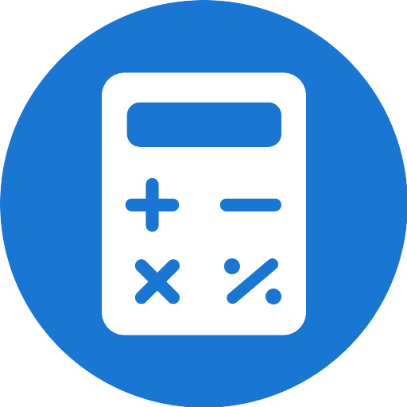

[](https://ko-fi.com/lbockaj)

Calculator apps are made of on-screen buttons. On a keypad phone like the Qin F21, Dumber Mini or Doov R77 Pro you
end up steering a cursor from button to button with the D-pad, even though the phone has real number keys right
under the screen. DumberKit: Calculator throws the button grid away: you type the calculation straight on the
keypad, the way [Calc-U-Later](https://github.com/kouta-kun/Calc-U-Later) does it, and press OK for the result.

It's built on [Fossify Calculator](https://github.com/FossifyOrg/Calculator), so it keeps its themes, its history and
its unit converter, reworked to fit a 480×640 screen and to work with the keys alone. Touch is switched off inside
the app, so nothing gets pressed by accident in your pocket.

<div align="center">
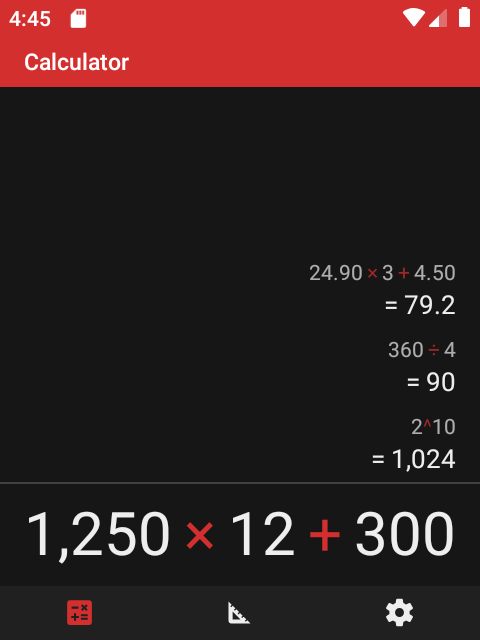
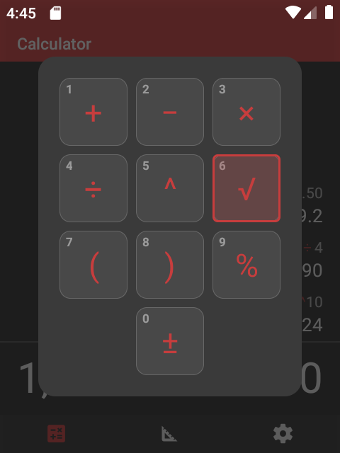
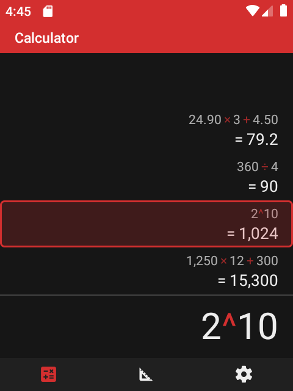
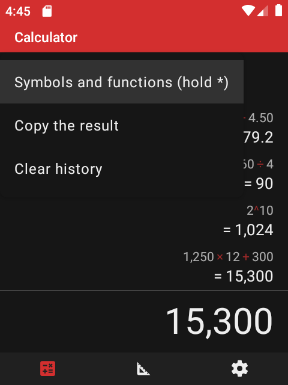
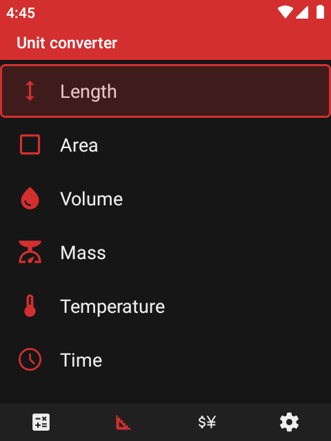
</div>

## Using it with the keys

The app has four tabs – **Calculator**, **Unit converter**, **Currency converter** and **Settings** – shown as icons
at the bottom. **← / →**
switch between them, and **Back** in the converter or settings tab takes you back to the calculator.

### Calculator

You type the calculation as you'd write it down. Numbers go in with the digit keys, and the **\*** key puts in an
operator: press it once for +, again for −, again for ×, again for ÷, and it goes round. Pressed at the very start it
makes the number negative. **#** is the decimal point, shown with your phone's own separator (a comma in many
countries).

| Key | What it does |
| --- | --- |
| **0–9** | Type numbers |
| **\*** | Add +, each further press turns it into −, ×, ÷ |
| **Hold \*** | Open the symbol palette (see below) |
| **#** | Decimal point |
| **OK** or **Call** (green key) | Show the result |
| **Back** | Delete the last character, or the whole result; with nothing typed it closes the app |
| **Hold Back** | Clear everything |
| **↑ / ↓** | Go through the history above the input |
| **Menu** | Symbols and functions, copy the result, clear the history |

The result replaces the calculation in the input, and the calculation moves up into the history. Keep typing an
operator to go on with the result, or a digit to start a new calculation. The usual order of operations applies:
10 − 2 + 3 is 11 and 2 + 3 × 4 is 14, and decimals are exact, so 0.1 + 0.2 gives 0.3.

**The symbol palette** – hold **\*** and a grid of square tiles shows up while you're still holding it. The tiles are
laid out like the keypad, so the digit at a tile's place puts its symbol in:

```
1 +    2 −    3 ×
4 ÷    5 ^    6 √
7 (    8 )    9 %
       0 ±
```

You can also move with the arrows and press OK. A new press of **\*** or **Back** closes the palette. Percent works
the way people use it on paper: 50 + 10% is 55, 200 × 10% is 20.

**The history** works like a paper tape: the newest calculation sits right above the input. **↑** picks the last
one and puts it back into the input, further presses go to older ones and **↓** comes back. You can change the
picked calculation and press OK to compute it again. The history is kept while the app is open, switching to
another app and back keeps it, and it's cleared once you close the app.

### Unit converter

The tab lists length, area, volume, mass, temperature, time, speed, pressure and energy. Pick one with **↑ / ↓** and
**OK**.

The converter shows two unit rows. Type a number into the selected row and the other one is worked out, it works in
both directions.

| Key | What it does |
| --- | --- |
| **↑ / ↓** | Select the upper or lower row |
| **0–9**, **#** | Type the value of the selected row |
| **← / →** | Previous / next unit of the selected row |
| **OK** | The list of all units for the selected row |
| **\*** | Swap the two units |
| **Hold \*** | Make a temperature negative |
| **Back** | Delete the last digit; with nothing typed it goes back to the list |
| **Hold Back** | Clear the value |
| **Menu** | Swap units, use the result in the calculator, clear the value |

*Use in the calculator* takes the converted value over to the calculator tab, ready to compute with.

<div align="center">
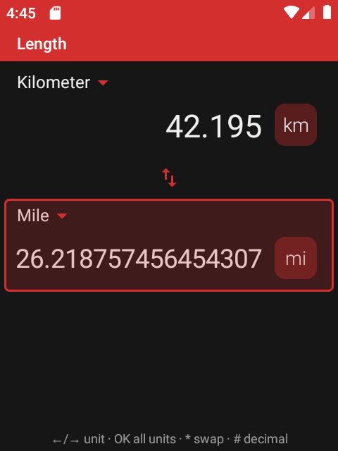
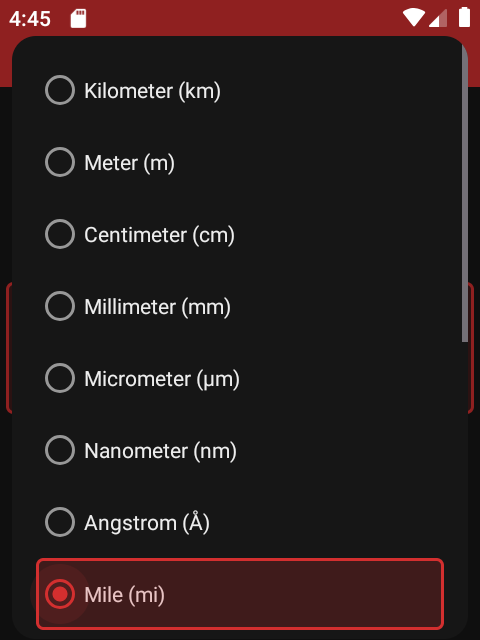
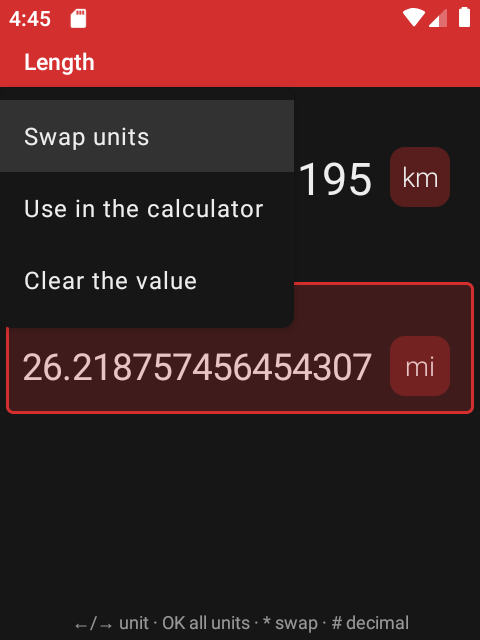
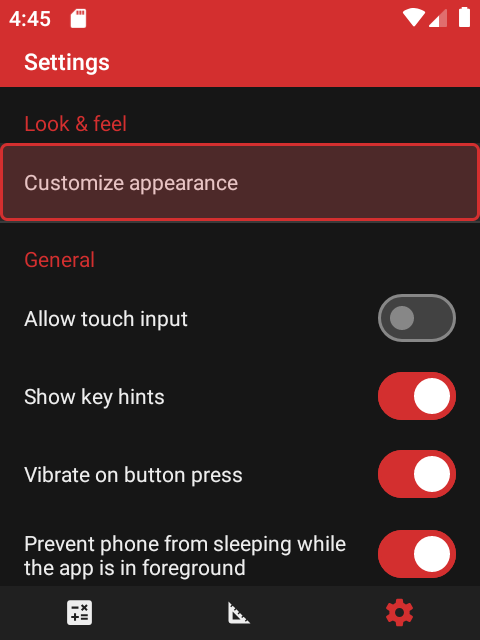
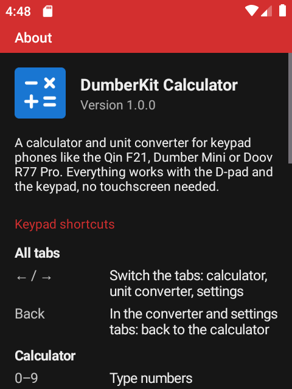
</div>

### Currency converter

The same two rows as the unit converter, with about 30 currencies (euro, dollar, pound, franc, koruna, złoty, forint,
yen…) at the reference rates of the European Central Bank. The ECB publishes them once per working day, around
16:00 CET.

| Key | What it does |
| --- | --- |
| **↑ / ↓** | Select the upper or lower currency |
| **0–9**, **#** | Type the amount of the selected row, the other one is converted |
| **OK** | The list of all currencies for the selected row |
| **\*** | Swap the two currencies |
| **Back** | Delete the last digit; with nothing typed it goes back to the calculator |
| **Hold Back** | Clear the amount |
| **Menu** | Swap, update the rates, use the result in the calculator, clear |

The rates are downloaded when you open the tab, if there's an internet connection and the ones on the phone are a few
hours old; nothing runs in the background. Without internet the converter keeps working with the last rates, and a
copy that comes with the app covers the very first start. The line under the converter shows when the rates were
last downloaded.

### Settings and colors

Every option in *Settings* is a row you can reach with the arrows. Screens where changes need confirming, like the
colors, end with **Cancel** / **Save** rows instead of icons in the top bar.

- **Colors** – *System* (follows Android), light, dark, dark red and other themes, or your own colors. The color
  picker works in steps: the hue bar on the left, OK, the shade square, OK, then *Cancel* or *Save*. **Back** steps
  back.
- **App icon** – blue by default, any other color can be picked; switching the theme doesn't change it.
- **Allow touch input** – off by default. Turn it on if you'd like to use the touchscreen in the app too.
- **Show key hints** – the short line of key hints at the bottom of the converter.
- **Vibrate on button press** and **Prevent phone from sleeping** while the app is open.
- **About** – the version and a full list of the keys on every screen.

## What else it does

- Numbers are shown the way your phone's language writes them, with spaces or commas between thousands.
- Very big and very small results switch to the 1.2E+20 form instead of filling the screen with zeros.
- The menu can copy the result, ready to paste into a text message.
- No ads and no tracking. The internet is used only to download the ECB's currency rates.
- Portrait only, sized for small screens. The calculator's own texts come with Fossify's translations into many
  languages; the keypad texts are in English and Slovak for now.

## Install

1. Download `dumberkit-calculator.apk` from the [latest release](../../releases/latest).
2. Open it on the phone and allow installing apps from that source when Android asks.
3. Start **Calculator** with the blue icon.

Requires Android 8.0 or newer.

## Build

```bash
./gradlew assembleFossRelease
```

The release build is signed with the key from `keystore.properties` (see `keystore.properties_sample`), the APK
ends up in `app/build/outputs/apk/foss/release/`. The calculations are covered by unit tests:
`./gradlew testFossDebugUnitTest`.

## License

DumberKit: Calculator is free software under the [GNU General Public License v3.0](LICENSE).

## Credits

The core of the app is [Fossify Calculator](https://github.com/FossifyOrg/Calculator) and its
[Commons](https://github.com/FossifyOrg/Commons) library (GPL-3.0) – the unit converter, the history, themes and
translations come from there. The idea of typing the calculation on the keypad comes from
[Calc-U-Later](https://github.com/kouta-kun/Calc-U-Later) by kouta-kun (GPL-3.0). DumberKit: Calculator is a modified
version, reworked in 2026 for keypad navigation and small screens. Thanks to the Fossify team, its translators and
kouta-kun.
